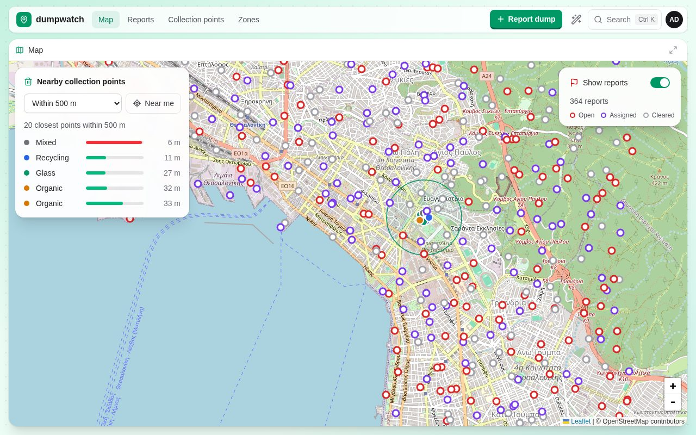
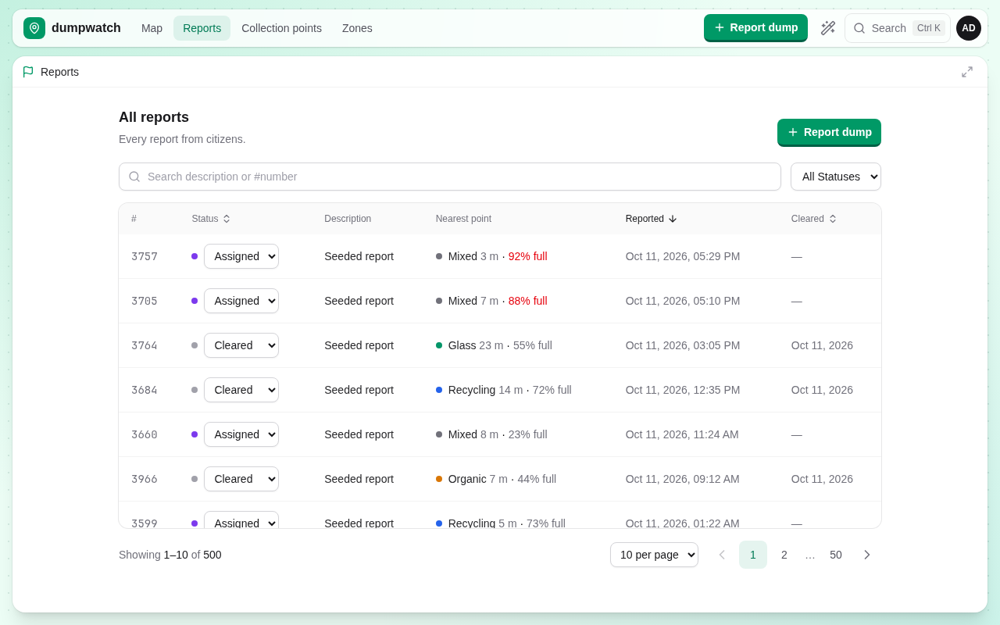
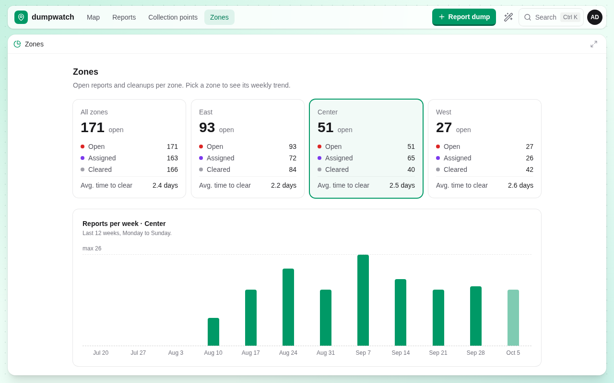
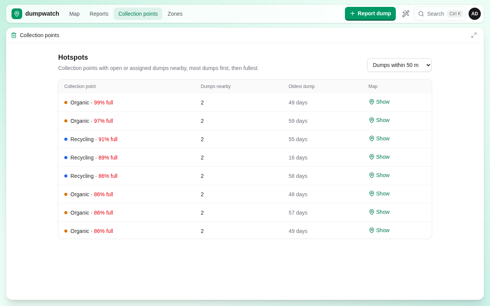
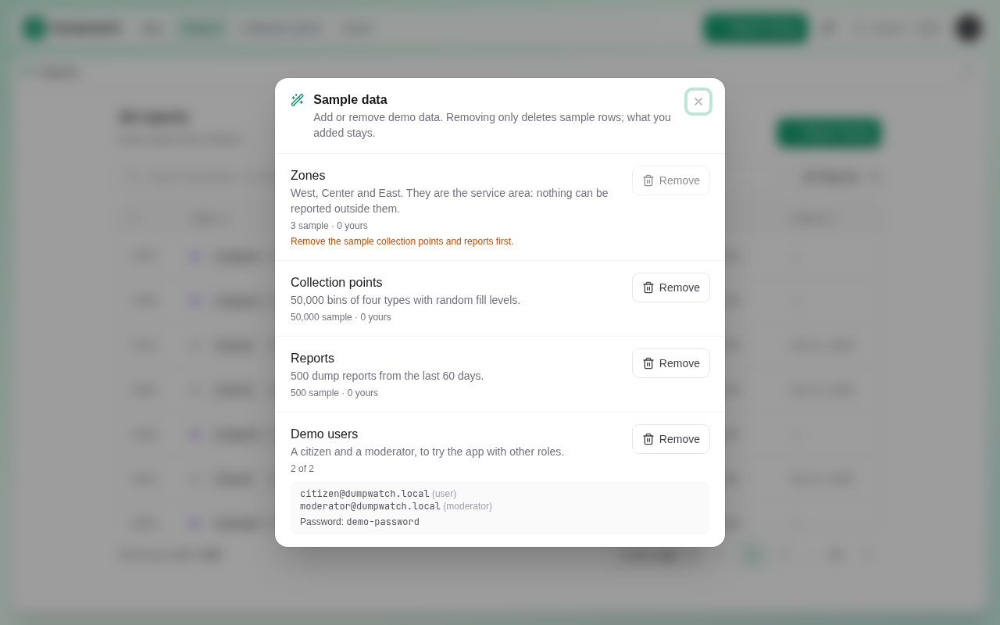

# dumpwatch

[](https://github.com/vvasileios/dumpwatch/actions/workflows/ci.yml)

Citizens report illegal dumping on a map. City staff see the nearest collection points, triage reports, and follow each zone on a dashboard.

Nuxt 4 · Vue 3 · TypeScript · PostgreSQL 18 + PostGIS 3.6 with **raw SQL** (`pg`, no ORM) · Better Auth · Leaflet · Tailwind 4 · dbmate · Docker Compose.

| Map | Reports |
| --- | --- |
|  |  |
| **Zone dashboard** | **Hotspots** |
|  |  |

## Run it in one minute

Needs Docker and `make`.

```sh
cp .env.example .env        # then set BETTER_AUTH_SECRET: openssl rand -base64 32
make up                     # db → migrations → app, opens http://localhost:3000
```

Sign in with `ADMIN_EMAIL` / `ADMIN_PASSWORD` from `.env`. The app starts empty: click the **wand** in the top bar to load sample data (3 zones, 50,000 collection points, 500 reports, a demo citizen and moderator).



## What it does

- **Citizens** pin a dump on the map (only inside the city's zones), describe it, and follow their own reports.
- **Map**: click anywhere for the 20 nearest collection points within a radius, with fill levels; toggle a layer of reports in view.
- **Reports** (`/reports`): search by text or `#id`, filter, sort, page; staff change the status inline; each row shows its nearest collection point.
- **Zones** (`/zones`, staff): open / assigned / cleared and average time to clear per zone, plus a 12-week trend.
- **Hotspots** (`/collection-points`, staff): collection points with unresolved dumps within 25 / 50 / 100 m, fullest first, each linking to the map.
- **Roles**: citizen, moderator, admin (Better Auth RBAC), enforced on every endpoint; pages only hide what you can't use.

## Design decisions worth a look

| Topic | Decision | Numbers / details |
| --- | --- | --- |
| Spatial queries | `geography` columns (metres), `ST_DWithin` for radius filters, KNN `<->` for "closest N" | `ST_DWithin` 2.1 ms vs `ST_Distance < x` 36 ms on 50k points |
| Report paging | Started with a keyset cursor, moved to page numbers + search for the UX; measured both | `count(*)` is the real cost of page numbers, not `OFFSET` |
| Search | `ILIKE` with `%` / `_` escaped, `#id` matches, `pg_trgm` GIN index | rare term: 2.1 ms with the index vs 26 ms without |
| Nearest point per row | `LEFT JOIN LATERAL … <-> … LIMIT 1` **after** paging | 4.5 ms vs 2.9 s when done before paging |
| Hotspots | `ST_DWithin` join driven from the ~340 unresolved reports, not 50k points | 17 ms vs 149 ms |
| Weekly trend | Weeks bucketed with `date_trunc(…, 'Europe/Athens')` | correct across daylight-saving changes; one GiST scan instead of 12 |
| Schema | dbmate migrations own everything, Better Auth tables included; a startup check prints the SQL if Better Auth's schema drifts | existing DB was baselined, not wiped |
| Sample data | `is_sample` column, seed/remove per entity in a transaction holding an advisory lock | removing never touches your data; two parallel clicks → one 200, one 409 |
| API contract | Zod on every input, one `parseInput` helper → `400 { field: [messages] }`; 401 / 403 / 404 / 409 / 422 | |

Every query was proven in `db/queries/` before it went into a handler. Full EXPLAIN results: [docs/performance.md](docs/performance.md).

## Tests

`make test` builds the production app, starts it against a fresh `dumpwatch_test` database, and runs 32 API tests with `node:test` (about 15 s). They check auth on every endpoint, validation errors, paging, search escaping, the nearest-point and hotspot queries against brute-force SQL, the seed manager's locking, and sign-in rate limiting. CI runs `make typecheck` and `make test` on every push.

## Make targets

| target | does |
| --- | --- |
| `make up` / `down` | start / stop the stack |
| `make logs` / `sh` / `psql` | follow logs, shell in the app, psql into the database |
| `make typecheck` | type-check app and server (vue-tsc) |
| `make test` | API tests against a fresh test DB + production build |
| `make migrate` / `rollback` | apply pending migrations / undo the latest |
| `make migration name=x` | new migration file in `db/migrations/` |
| `make seed` | load all sample data (same SQL as the wand) |
| `make sql f=file.sql` | run a SQL file, e.g. an EXPLAIN experiment in `db/queries/` |
| `make install pkg=foo` | add an npm package (inside the container) |
| `make reset` | delete the DB and node_modules volumes (all data lost) |

## Where things are

- `app/`: pages, one composable per feature (state + fetching), components that draw state and emit events, a small shared UI kit in `components/shared/`
- `server/api/`: Nitro file routes, SQL as constants in each handler; `server/utils/` for the pool, auth guards, validation, seed logic
- `shared/`: types and limits used by both sides
- `db/migrations/` (dbmate), `db/schema.sql` (generated), `db/seed/`, `db/queries/` + `db/explain/` (EXPLAIN experiments)
- `tests/`: API tests

More detail: [docs/architecture.md](docs/architecture.md) (file map, data model, auth), [docs/PROGRESS.md](docs/PROGRESS.md) (what's done, what's next), [docs/design/multi-tenancy.md](docs/design/multi-tenancy.md) (planned: municipalities, contractors, row-level security).

## Notes

- PostGIS takes `(lng, lat)`; Leaflet takes `[lat, lng]`.
- Zones are land only (coastline © OpenStreetMap contributors, ODbL), so the sea is outside the service area.
- On Windows, keep the repo inside WSL2, or hot reload won't see file changes.
- `node_modules` lives in a Docker volume; run `npm install` on the host once if you want editor autocomplete.
